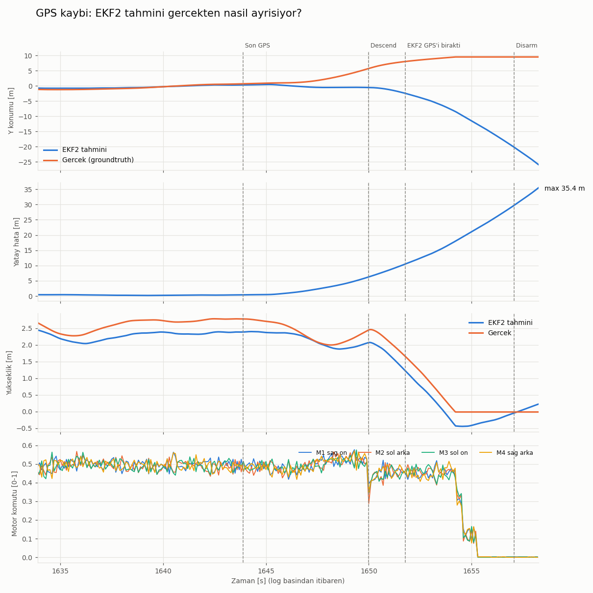
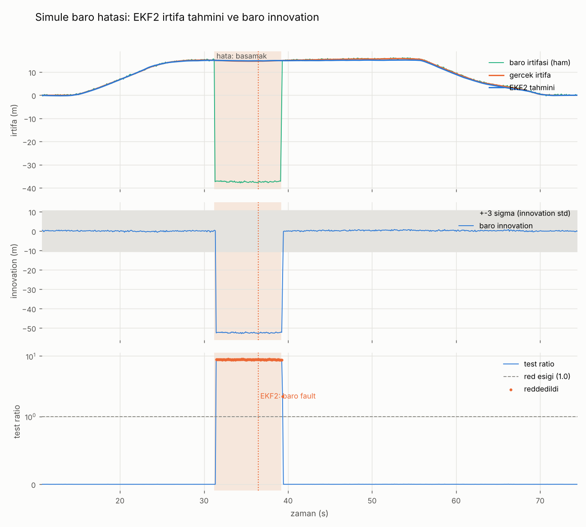

# PX4 SITL çalışmalarım

STM32 ve FreeRTOS üzerinde gömülü yazılım geliştiriyorum. Bu repoda drone uçuş yazılımı PX4'ü öğrenirken yaptıklarımı tutuyorum. Elimde donanım olmadığı için her şeyi simülasyonda (SITL) yaptım: PX4'ü kaynaktan derledim, QGroundControl ile uçurdum, uçuş loglarını analiz ettim.

## Okuma sırası

1. [PX4, Pixhawk ve ArduPilot](docs/01-px4-pixhawk-ardupilot.md): Uçuş kontrolcüsü nedir, donanım ve yazılım tarafı, PX4'ün temel kavramları ve FreeRTOS karşılıkları, ArduPilot ile karşılaştırma
2. [SITL, simülatörler ve QGroundControl](docs/02-sitl-ve-simulatorler.md): Donanım olmadan nasıl çalıştım, hangi araçları kullandım
3. [Kurulum ve kullandığım komutlar](docs/03-kurulum-ve-komutlar.md): Hangi komutu nerede ve neden çalıştırdım, adım adım
4. [PX4 mimarisi: uORB ve modüller](docs/04-mimari-uorb.md): Modül şeması, thread'ler, topic'ler, ilk kod değişikliğim
5. [Kontrol döngüleri ve GPS kaybı](docs/05-kontrol-ve-gps-kaybi.md): Havada kontrol zinciri, GPS kesilince ne oluyor, log analizi
6. [Kendi modülüm, simüle baro sürücüsü ve MAVLink](docs/06-modul-surucu-ve-mavlink.md): Work queue modülü, hata enjekte edilebilen baro sürücüsü, pymavlink ile görev, baro hatasında EKF2'nin tepkisi





## Klasörler

```
docs/       notlar (yukarıdaki sırayla)
scripts/    sitl.sh: derle ve çalıştır, pxh.sh: çalışan PX4'e komut gönder,
            mission.py: MAVLink ile arm, kalkış ve görev
analysis/   uçuş logu analiz scriptleri (gps_loss.py, baro_fault.py) ve grafikler
```

PX4 üzerindeki kod değişikliklerim fork'umda: [batuuhnk/PX4-Autopilot](https://github.com/batuuhnk/PX4-Autopilot/tree/learning/sitl-week1)

## Çalıştırma

```bash
git clone --recursive --depth 1 --branch v1.17.0 https://github.com/PX4/PX4-Autopilot.git ~/px4/PX4-Autopilot
./scripts/sitl.sh                            # derle ve SIH ile başlat
./scripts/pxh.sh listener vehicle_attitude   # bir topic'i oku
```

Ayrıntılı kurulum adımları 3. bölümde. Log analizi (pyulog ve matplotlib gerekiyor, PX4'ün Docker imajında ikisi de var):

```bash
python3 analysis/gps_loss.py <ucus_logu.ulg> analysis/plots
python3 analysis/baro_fault.py <ucus_logu.ulg> analysis/plots
```

MAVLink görevi (pymavlink gerekiyor, PX4 çalışırken):

```bash
python3 scripts/mission.py                              # takeoff, kare görev, RTL
python3 scripts/mission.py --takeoff-only --hover 30    # kalk, bekle, in
```

## Sırada

- SIH simülatörüne GPS hata enjeksiyonu eklemek (şu an çalışmıyor, bkz. 5. bölüm)
- ArduPilot mimarisiyle daha ayrıntılı karşılaştırma
