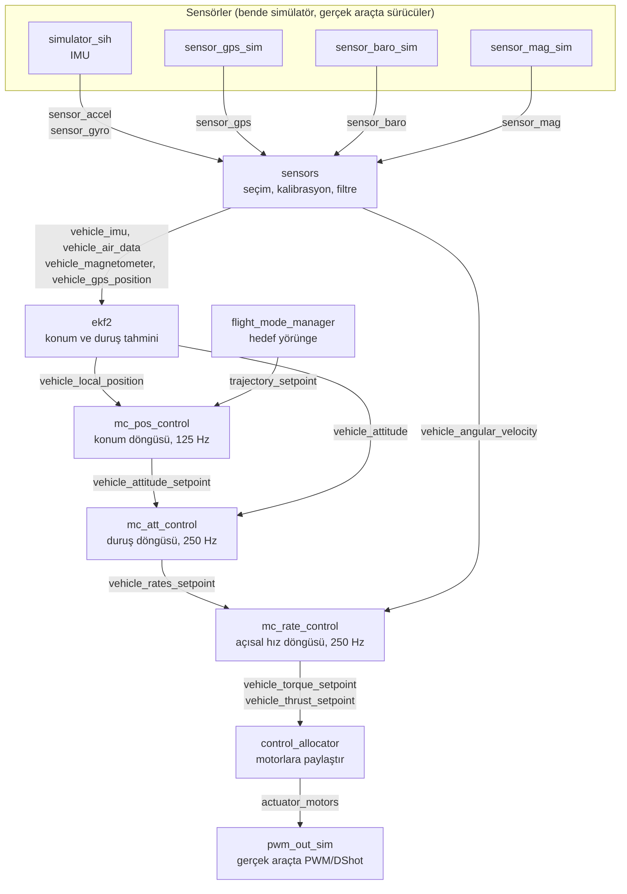
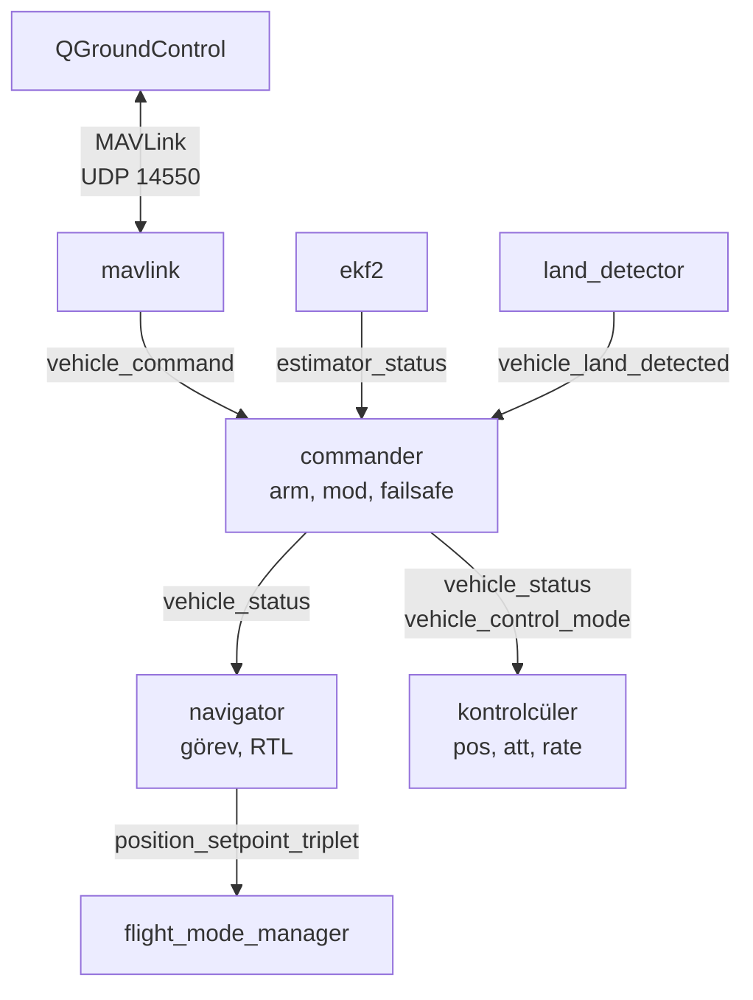

# 4. PX4 mimarisi: uORB ve modüller

Bu bölümde PX4'ü çalışırken inceledim. Komutları PX4'ün konsolunda (`pxh>`) çalıştırdım. Modüllerin hangi topic'leri yayınladığını da kaynak koddan kontrol ettim. Geçen kavramların kısa tanımları ve FreeRTOS karşılıkları [kavramlar sözlüğünde](kavramlar.md).

## Genel şema

PX4'te modüller birbirini doğrudan çağırmıyor. Her modül sonucunu bir uORB topic'ine yayınlıyor, ihtiyacı olan modül de o topic'e abone oluyor. Aşağıdaki şemalarda kutular modüller, oklar üzerindeki isimler topic'ler.

### Sensörden motora veri yolu (multicopter)



`pwm_out_sim` motor komutlarını `actuator_outputs_sim` topic'iyle simülatöre geri veriyor, simülatör de aracın yeni hareketini hesaplıyor. Döngü böyle kapanıyor.

### Karar ve haberleşme



`commander` uçuş modunu ve arm durumunu `vehicle_status` ile herkese duyuruyor; kontrolcüler hangi döngülerin açık olacağını `vehicle_control_mode`'dan okuyor.

`logger` neredeyse bütün topic'lere abone, uçuş boyunca hepsini `.ulg` dosyasına yazıyor. Şemayı kalabalıklaştırmamak için oklarını çizmedim.

### Katman katman modüller

Her katmanda verinin kodda nerede üretildiğini de yazdım. Dosya yolları `PX4-Autopilot/src/modules/` altına göre.

**Sensörler.** Gerçek araçta her sensörün kendi sürücüsü var (örneğin ICM-42688 IMU sürücüsü), `src/drivers/` altında. Bende bunların yerine simülatör modülleri çalışıyor:

- IMU: `simulator_sih` önce aracın fiziğini hesaplıyor (`Sih::read_motors()` motor komutlarını okuyor, `Sih::generate_force_and_torques()` kuvvetleri, `Sih::equations_of_motion()` hareketi hesaplıyor). Sonra `Sih::reconstruct_sensors_signals()` bu hareketten ivme ve gyro değerlerini üretip `sensor_accel` ve `sensor_gyro` olarak yayınlıyor (`simulation/simulator_sih/sih.cpp`).
- GPS: `SensorGpsSim::Run()` içinde `sensor_gps` yayınlanıyor (`simulation/sensor_gps_sim/SensorGpsSim.cpp`).
- Barometre: `SensorBaroSim::Run()` → `sensor_baro` (`simulation/sensor_baro_sim/SensorBaroSim.cpp`).
- Manyetometre: `SensorMagSim::Run()` → `sensor_mag` (`simulation/sensor_mag_sim/SensorMagSim.cpp`).

`simulator_sih` ayrıca aracın gerçek konumunu `Sih::publish_ground_truth()` içinde `*_groundtruth` topic'lerine yayınlıyor. 5. bölümde EKF2'nin tahminini bununla karşılaştırdım.

**Sensör işleme.** `sensors` modülü birden fazla IMU varsa hangisinin kullanılacağını seçiyor (`sensors/voted_sensors_update.cpp`), kalibrasyonu uyguluyor ve veriyi filtreliyor. Alt parçaları ayrı work item'lar:

- `VehicleIMU::Publish()` → `vehicle_imu`. Kalibrasyon burada uygulanıyor (`sensors/vehicle_imu/VehicleIMU.cpp`).
- `VehicleAngularVelocity::Run()` → `vehicle_angular_velocity`. Gyro filtresi (`IMU_GYRO_CUTOFF`) `VehicleAngularVelocity::FilterAngularVelocity()` içinde (`sensors/vehicle_angular_velocity/VehicleAngularVelocity.cpp`).
- `VehicleAirData::Run()` → `vehicle_air_data`, `VehicleMagnetometer::Run()` → `vehicle_magnetometer`, `VehicleGPSPosition::Run()` → `vehicle_gps_position`.

**Tahmin.** `ekf2`, IMU'yu GPS, barometre ve manyetometreyle birleştirip (sensör füzyonu) aracın konumunu, hızını ve duruşunu tahmin ediyor. Ana döngü `EKF2::Run()`; sonuçları `EKF2::PublishAttitude()` (`vehicle_attitude`) ve `EKF2::PublishLocalPosition()` (`vehicle_local_position`) yayınlıyor (`ekf2/EKF2.cpp`). Filtrenin kendisi `ekf2/EKF/` klasöründe.

**Karar.** `commander` aracın genel durumunu yönetiyor: arm/disarm, uçuş modu, sağlık kontrolleri ve failsafe kararları. Gelen komutlar `Commander::handle_command()` içinde işleniyor, `vehicle_status` ise `Commander::run()` içinde yayınlanıyor (`commander/Commander.cpp`). `navigator` görev (mission), eve dönüş (RTL) gibi otomatik modlarda hedef noktaları üretiyor; `Navigator::publish_position_setpoint_triplet()` (`navigator/navigator_main.cpp`). `land_detector` aracın yere inip inmediğini anlıyor; `LandDetector::Run()` → `vehicle_land_detected`.

**Kontrol.** İç içe geçmiş döngüler (kaskad kontrol). Dıştan içe doğru: konum → duruş → açısal hız. Her döngü bir içtekine hedef veriyor ve içteki döngüler daha hızlı çalışıyor.

- `FlightModeManager::generateTrajectorySetpoint()` → `trajectory_setpoint` (`flight_mode_manager/FlightModeManager.cpp`)
- `MulticopterPositionControl::Run()` → `vehicle_attitude_setpoint` (`mc_pos_control/MulticopterPositionControl.cpp`)
- `MulticopterAttitudeControl::Run()` → `vehicle_rates_setpoint` (`mc_att_control/mc_att_control_main.cpp`)
- `MulticopterRateControl::Run()` → `vehicle_torque_setpoint`, `vehicle_thrust_setpoint` (`mc_rate_control/MulticopterRateControl.cpp`)
- `ControlAllocator::publish_actuator_controls()` → `actuator_motors`. İstenen tork ve itkiyi dört motora paylaştıran kısım (`control_allocator/ControlAllocator.cpp`).

**Çıkış.** Gerçek araçta motor sürücüleri (ESC) PWM ya da DShot ile sürülüyor. Bende `PWMSim::updateOutputs()` motor komutlarını `actuator_outputs_sim` olarak simülatöre geri veriyor (`simulation/pwm_out_sim/PWMSim.cpp`), `Sih::read_motors()` de bunu okuyor. Döngü böyle kapanıyor.

**Haberleşme.** `mavlink` QGroundControl ile konuşuyor: telemetriyi gönderiyor, QGC'den gelen komutları (kalkış, mod değiştirme) içeri alıyor. Gelen komut mesajları `MavlinkReceiver::handle_message_command_both()` içinde `vehicle_command` olarak yayınlanıyor (`mavlink/mavlink_receiver.cpp`).

## Thread'ler (task'lar)

Başlangıçta "PX4'te her modül ayrı bir task" diye düşünüyordum. Bu doğru değilmiş.

SITL'de PX4'ün her task'ı bir Linux thread'i olduğu için hepsini Linux'tan listeleyebildim:

```bash
docker exec px4dev bash -c 'for t in /proc/$(pgrep -x px4)/task/*; do cat $t/comm; done'
```

Toplam 28 thread çıktı. Ana `px4` thread'i, `wq:manager` (work queue'ları oluşturan yönetici), `hpwork`, `lpwork` ve `wkr_hrt` (zamanlayıcı işleri) gibi altyapı thread'lerini ayırınca geri kalanlar ikiye ayrılıyor:

**Kendi thread'i olan modüller:**

```
commander               arm, mod, failsafe
navigator               görev ve otomatik modlar
sih                     simülatör
logger, log_writer_file log kaydı (biri toplar, diğeri dosyaya yazar)
mavlink_if0..4          her MAVLink bağlantısı için gönderme thread'i (5 bağlantı)
mavlink_rcv_if0..4      ve alma thread'i
dataman                 görev noktalarını kalıcı olarak saklar
uxrce_dds_client        ROS 2 bağlantısı
```

**Work queue thread'leri.** Geri kalan modüllerin kendi thread'i yok. Ortak bir thread'e "work item" olarak kayıtlılar ve sırası gelince çalışıyorlar. `work_queue status` çıktısı:

```
wq:rate_ctrl            (en yüksek öncelik)
    vehicle_angular_velocity, mc_rate_control, control_allocator, pwm_out_sim
wq:INS0
    vehicle_imu, ekf2
wq:nav_and_controllers
    sensors, mc_att_control, mc_pos_control, flight_mode_manager, land_detector,
    mc_hover_thrust_estimator, vehicle_acceleration, vehicle_air_data,
    vehicle_gps_position, vehicle_magnetometer
wq:hp_default
    sensor_baro_sim, sensor_gps_sim, sensor_mag_sim, battery_simulator, gyro_fft, ...
wq:lp_default
    load_mon, gyro_calibration, parameters, ...
```

Yani yaklaşık 30 modül 5 work queue thread'i üzerinde çalışıyor. Neden böyle olduğunu `wq:rate_ctrl` iyi gösteriyor: gyro verisinden motor komutuna giden zincirin tamamı aynı thread'de. Araya context switch girmeden tek bir 4 ms'lik döngüde bitiyor. Az thread kullanmak, her birine ayrı stack ayırmadığı için RAM'den de tasarruf sağlıyor.

Küçük bir detay: Linux'ta thread adı en fazla 15 karakter olabiliyor. `wq:nav_and_controllers` 22 karakter olduğu için listede kendi adıyla değil `px4` olarak görünüyor.

### Modüller nasıl tetikleniyor?

İki yol var: bir topic'e yeni veri gelince (olay tabanlı) ya da belirli aralıklarla (periyodik). `work_queue status` çıktısında parantez içinde süre yazanlar periyodik çalışanlar.

Kaynak kodda `mc_rate_control` örneği:

- `MulticopterRateControl.cpp`: Kurucuda `WorkItem(MODULE_NAME, px4::wq_configurations::rate_ctrl)` ile `wq:rate_ctrl` thread'ine bağlanıyor.
- `MulticopterRateControl.hpp`: `uORB::SubscriptionCallbackWorkItem _vehicle_angular_velocity_sub` satırı, `vehicle_angular_velocity` yayınlandığında modülün `Run()` fonksiyonunu kuyruğa alıyor. ISR'den `xTaskNotifyGive()` ile bir task'ı uyandırmaya benziyor.
- Thread'lerin öncelik ve stack ayarları `platforms/common/include/px4_platform_common/px4_work_queue/WorkQueueManager.hpp` dosyasında.

## uORB trafiği

`uorb top -1` komutu her topic'in ne sıklıkla yayınlandığını ve kaç modülün dinlediğini gösteriyor. Öne çıkanlar:

| Topic | Hız | Abone sayısı | Kuyruk |
|---|---|---|---|
| `sensor_gyro`, `sensor_accel` | 250 Hz | 6, 5 | 8 |
| `vehicle_attitude` | 250 Hz | 19 | 1 |
| `vehicle_local_position` | 125 Hz | 41 | 1 |
| `vehicle_rates_setpoint` | 250 Hz | 4 | 1 |
| `actuator_motors` | 250 Hz | 1 | 1 |
| `vehicle_status` | 2 Hz | 61 | 1 |

Fark ettiklerim:

- Çoğu topic'in kuyruk derinliği 1. Yani okuyan modül her zaman sadece en son değeri görüyor, yeni veri eskisinin üzerine yazılıyor. FreeRTOS'taki uzunluğu 1 olan kuyruk ve `xQueueOverwrite()` ile aynı mantık.
- Ham gyro ve ivme verisinin kuyruğu 8. Bunlar filtrelere girdiği için örnek kaybolmaması gerekiyor.
- `vehicle_status` saniyede sadece 2 kez yayınlanıyor ama 61 modül dinliyor. Seyrek değişen ama herkesin bilmesi gereken bir bilgi (arm durumu, uçuş modu).
- Kontrol döngülerinin hızları kademeli: konum 125 Hz, duruş ve açısal hız 250 Hz.

## İlk kod değişikliğim

PX4'ün örnek modüllerinden `px4_simple_app`'i inceledim (`src/examples/px4_simple_app/px4_simple_app.c`, tüm kod `px4_simple_app_main()` fonksiyonunda). `vehicle_acceleration`'a abone olup `px4_poll()` ile veri bekliyor ve ekrana basıyor. Ama aynı zamanda bu ivme değerlerini `orb_publish()` ile `vehicle_attitude` topic'ine de yayınlıyor. Oysa bu topic'i EKF2 de yayınlıyor ve attitude kontrolcüsü onu kullanıyor. Bu örnek uçan bir araçta çalıştırılsa kontrolcü yanlış veri alırdı.

Yayınlama kısmını kaldırdım, mesajı değiştirdim, derleyip çalıştırdım:

```
INFO  [px4_simple_app] Merhaba PX4 - ilk modulum!
INFO  [px4_simple_app] Accelerometer:    -0.0780    0.0432   -9.8018
INFO  [px4_simple_app] Accelerometer:    -0.0814   -0.0319   -9.7220
...
```

Araç yerde hareketsiz dururken Z ekseni -9.8 okudu. Araç düz durduğu için 9.8'in tamamının Z'de olması beklenen bir şey; dikkat çeken kısım işaret. İvmeölçer yerçekimini doğrudan hissedemiyor, aracı yukarı iten kuvveti ölçüyor (yerdeyken yerin, havadayken motorların itmesi). PX4'te gövde ekseni FRD (ileri, sağ, aşağı) olduğu için yukarı yönlü bu kuvvet eksi çıkıyor. Aynı sebeple serbest düşüşte ivmeölçer 0 okur.

Değişiklik: [batuuhnk/PX4-Autopilot@a573d42](https://github.com/batuuhnk/PX4-Autopilot/commit/a573d4298d5792f6698205de961f43782ffa3e36)

Önceki: [3. Kurulum ve komutlar](03-kurulum-ve-komutlar.md) · Sonraki: [5. Kontrol döngüleri ve GPS kaybı](05-kontrol-ve-gps-kaybi.md)
