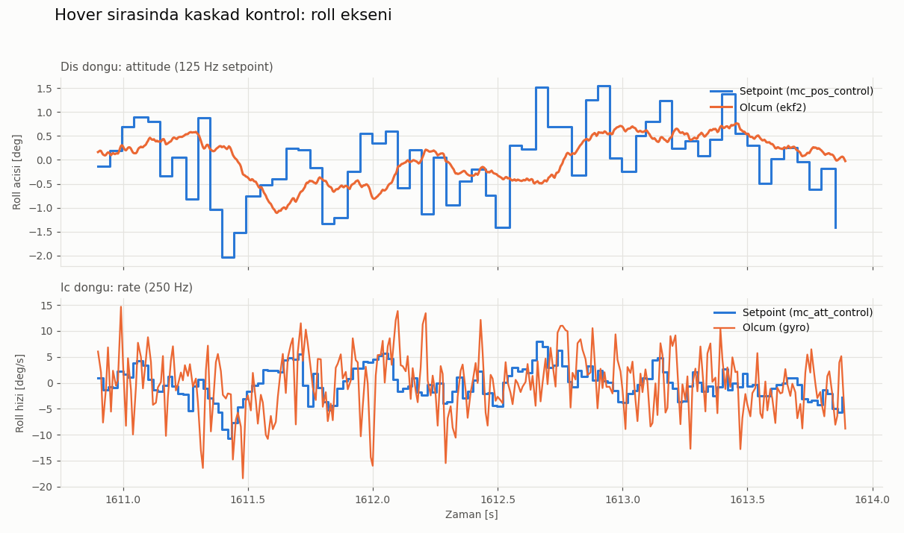
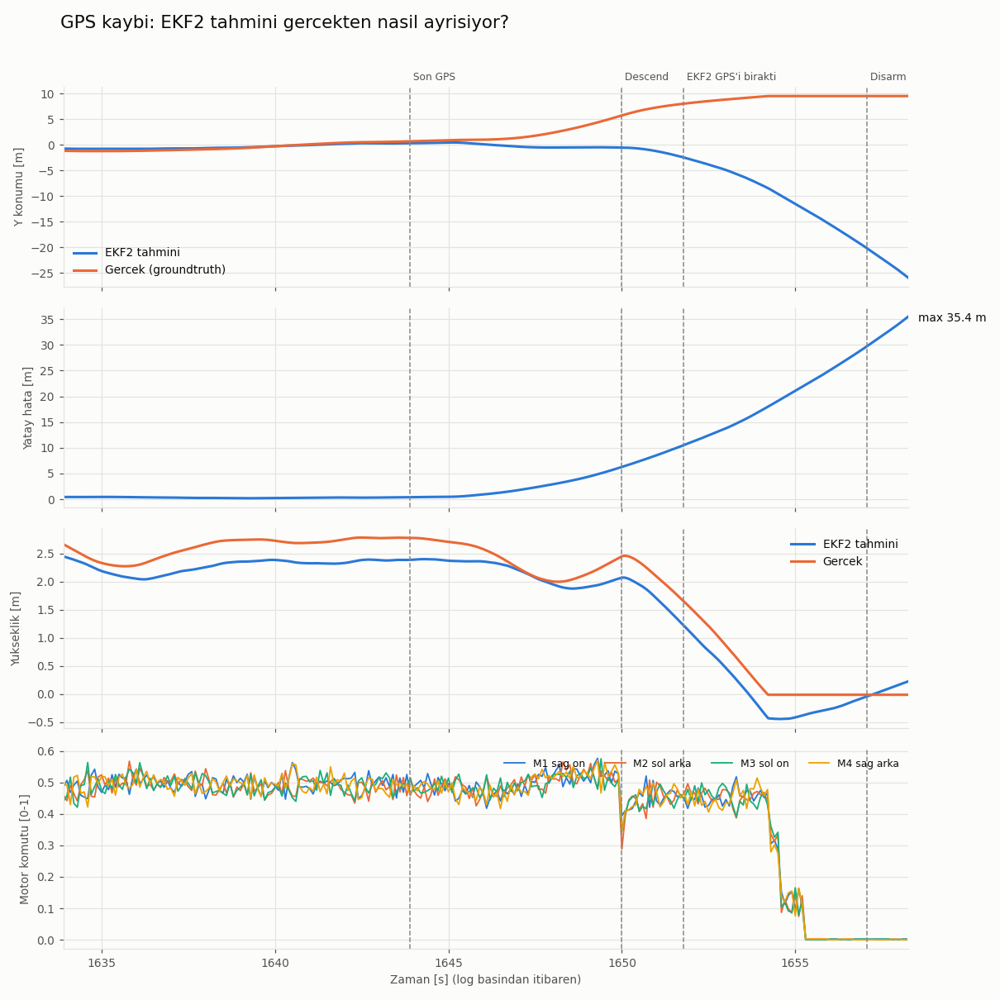

# 5. Kontrol döngüleri ve GPS kaybı

## Aracı nasıl uçurdum?

Drone'u elle (kumanda ya da joystick ile) uçurmadım. PX4'ün otomatik kalkış modunu kullandım; araç kendi kendine kalkıp havada bekledi. QGroundControl'ü bu sırada sadece izlemek için açık tuttum: haritada konumu, yüksekliği ve uçuş modunu oradan takip ettim.

### Kalkış komutu

PX4 ayrı bir terminalde `~/px4/sitl.sh` ile çalışırken, **Ubuntu terminalinden** şu komutu gönderdim:

```bash
~/px4/pxh.sh commander takeoff
```

Bu, PX4 konsoluna `commander takeoff` yazmakla aynı şey. Sonrasında olanlar:

1. `commander takeoff` komutu iki ayrı `vehicle_command` gönderiyor: önce "Takeoff moduna geç" (`VEHICLE_CMD_NAV_TAKEOFF`), bu kabul edilirse "arm et". Kodu `Commander::custom_command()` içinde (`commander/Commander.cpp`).
2. Bu komutları `Commander::handle_command()` işliyor: modu **Takeoff**'a alıyor ve aracı arm ediyor (motorlar çalışıyor).
3. Kalkışı `navigator`'ın Takeoff modu yürütüyor. Hedef yüksekliği `Takeoff::set_takeoff_position()` hesaplıyor: o anki yükseklik + `MIS_TAKEOFF_ALT` (varsayılan 2.5 m, `navigator/mission_params.c`). Araç bu yüksekliğe dikey olarak tırmandı.
4. Hedef yüksekliğe ulaşınca mod kendiliğinden **Hold**'a geçti. Araç olduğu yerde asılı kaldı (hover).

Yüksekliği birkaç saniyede bir okuyarak tırmanışı da takip ettim:

```bash
~/px4/pxh.sh listener vehicle_local_position
```

`z` değeri 0'dan -2.2'ye indi. PX4 dünya ekseninde NED (kuzey, doğu, aşağı) kullandığı için yukarı çıkmak z'nin eksi yönde büyümesi demek.

### QGroundControl'den de yapılabilirdi

QGC'deki **Takeoff** düğmesi aynı işi yapıyor. Fark sadece komutun geldiği yol:

```
QGC "Takeoff" düğmesi  -> MAVLink mesajı (UDP 14550) -> mavlink modülü -> vehicle_command -> commander
pxh> commander takeoff ->                                                   vehicle_command -> commander
```

QGC'den gelen MAVLink komutunu `vehicle_command`'a çeviren kod `MavlinkReceiver::handle_message_command_both()` (`mavlink/mavlink_receiver.cpp`).

İki durumda da `commander` aynı `vehicle_command` mesajını alıyor (4. bölümdeki "Karar ve haberleşme" şeması). Ben terminali tercih ettim, çünkü komutları ve ölçümleri aynı yerden, tekrarlanabilir şekilde çalıştırabiliyordum.

### Uçuştaki diğer komutlar

Araç havadayken sırasıyla şunları çalıştırdım (hepsi Ubuntu terminalinden, `pxh.sh` ile):

```bash
~/px4/pxh.sh param set SYS_FAILURE_EN 1    # hata enjeksiyonunu aç
~/px4/pxh.sh failure gps off               # GPS hatası dene (SIH'te çalışmadı, aşağıda)
~/px4/pxh.sh sensor_gps_sim stop           # GPS'i gerçekten kes
~/px4/pxh.sh sensor_gps_sim start          # iniş bittikten sonra GPS'i geri aç
```

İnişi ben komut vererek yapmadım. GPS kesilince PX4'ün failsafe mekanizması aracı kendisi indirdi ve motorları kapattı. Bu da deneyin asıl gözlemlerinden biri oldu.

## Havada kontrol zinciri

Araç yaklaşık 2.2 m'de havada sabit dururken (hover) her kontrol katmanının girişini ve çıkışını okudum:

| Katman | Hedef | Ölçülen |
|---|---|---|
| Konum | z = -2.246 m | z = -2.234 m |
| Attitude | roll 0.5°, pitch -0.2° | roll 0.3°, pitch -0.6° |
| Rate | roll -0.05 rad/s | roll 0.16 rad/s |
| Tork | x = +0.039 | |
| Motorlar | 0.451, 0.519, 0.496, 0.461 | |

Motorların ortalaması 0.48, yani araç havada kalmak için motorlarının yaklaşık yarısını kullanıyor. Sol motorlar (M2, M3) sağdakilerden biraz fazla dönüyor; bu da tork satırındaki pozitif roll değeriyle (aracı sağa yatırma) uyumlu.

Bu değerleri sırayla okuduğum için aralarında birkaç yüz milisaniye fark var. Kesin karşılaştırma için uçuş logunu kullandım:



Üstteki grafikte konum kontrolcüsünün istediği açı ±1.5° arasında sıçrıyor, gerçek açı ise yumuşak ilerliyor. Alttaki grafikte gyro ölçümü çok gürültülü, rate kontrolcüsü gürültüyü değil genel eğilimi takip ediyor. Kontrolcüye giden gyro verisi önce `VehicleAngularVelocity::FilterAngularVelocity()` içinde alçak geçiren filtreden geçiyor (`IMU_GYRO_CUTOFF` parametresi, `sensors/vehicle_angular_velocity/VehicleAngularVelocity.cpp`).

## GPS kaybı deneyi

Araç havadayken GPS'i kesip EKF2'nin (durum tahmincisi) ve failsafe mekanizmasının ne yaptığına baktım.

### `failure gps off` çalışmadı

PX4'te hata simülasyonu için `failure` komutu var. GPS'i kesmek için `failure gps off` yazdım, ama `Timeout waiting for ack` hatası aldım ve GPS çalışmaya devam etti. Sebebini kaynak kodda buldum.

**`failure` komutu GPS'i kendisi kesmiyor.** Kodu `src/systemcmds/failure/failure.cpp` dosyasındaki `inject_failure()` fonksiyonu. Yaptığı iş `vehicle_command` topic'ine "GPS'e hata enjekte et" (`VEHICLE_CMD_INJECT_FAILURE`) mesajı yayınlamak ve birinin "tamam" cevabını (`vehicle_command_ack`) beklemek. Cevap gelmezse zaman aşımı veriyor. GPS'i gerçekten kesmek, GPS verisini üreten modülün işi.

**GPS verisini hangi modülün ürettiği simülatöre göre değişiyor:**

- Gazebo Classic ve jMAVSim ayrı programlar. PX4'ün içindeki `simulator_mavlink` modülü onlarla konuşan bir köprü; GPS dahil sensör verilerini oradan alıp içeri aktarıyor.
- Yeni Gazebo da ayrı bir program, ama köprüsü başka: `gz_bridge`. GPS verisini `GZBridge::navSatCallback()` içinde `sensor_gps` olarak yayınlıyor (`src/modules/simulation/gz_bridge/GZBridge.cpp`).
- SIH'te ayrı bir program yok. GPS verisini PX4'ün içindeki `sensor_gps_sim` modülü üretiyor: `SensorGpsSim::Run()` her 125 ms'de bir `sensor_gps` yayınlıyor (`src/modules/simulation/sensor_gps_sim/SensorGpsSim.cpp`). `simulator_mavlink` hiç çalışmıyor.

```
Gazebo Classic / jMAVSim:
  failure gps off -> vehicle_command -> simulator_mavlink -> GPS'i keser, "tamam" der

SIH (bende):
  failure gps off -> vehicle_command -> sensor_gps_sim    -> mesajı dinlemiyor
                                        commander         -> "başka modülün işi" diye geçiyor
                                     -> kimse cevap vermiyor -> Timeout
```

Mesajı dinleyen kod sadece `src/modules/simulation/simulator_mavlink/SimulatorMavlink.cpp` içindeki `SimulatorMavlink::check_failure_injections()` fonksiyonunda:

```cpp
if (failure_unit == vehicle_command_s::FAILURE_UNIT_SENSOR_GPS) {
    if (failure_type == vehicle_command_s::FAILURE_TYPE_OFF) {
        PX4_WARN("CMD_INJECT_FAILURE, GPS off");
        _gps_blocked = true;    // bundan sonra GPS verisini içeri aktarma
    }
```

`sensor_gps_sim` ise `vehicle_command` topic'ine abone bile değil, mesajı hiç görmüyor. Kaynak kodun tamamında `FAILURE_UNIT_SENSOR_GPS` sadece `failure.cpp` ve `SimulatorMavlink.cpp`'de geçiyor. Yani bu komut yeni Gazebo'da (`gz_bridge`) da çalışmıyor, sadece Gazebo Classic ve jMAVSim'de çalışıyor. CAN bus'ta "GPS kapan" mesajı gönderip ACK beklemek gibi: GPS kartının firmware'i o mesaj ID'sini dinlemiyorsa mesaj dolaşıyor, kimse almıyor, gönderen timeout'a düşüyor.

`commander` tarafında da bu komut bilerek pas geçiliyor: `Commander::handle_command()` içinde "handled by other parts of the system" yorumlu `case` listesinde (`commander/Commander.cpp`).

**Ne yaptım:** Mesajla "kapan" demek işe yaramadığı için GPS verisini üreten modülü doğrudan durdurdum (`sensor_gps_sim stop`). Sonuç aynı: PX4'e artık GPS verisi gelmiyor. Gerçek araçta GPS kablosunun kopması gibi.

Bu SIH'te (ve yeni Gazebo'da) gerçek bir eksiklik. Düzeltmek için `simulator_mavlink`'tekine benzer kodu `sensor_gps_sim`'e eklemek gerekiyor: `vehicle_command`'a abone olmak, GPS hatası gelince veri üretmeyi durdurmak ve cevap (ack) göndermek. Sıradaki çalışmam bu olacak.

### GPS kesikken neyi izledim?

GPS'i kestikten sonra 75 saniye boyunca her 3 saniyede bir şu topic'leri okudum (Ubuntu terminalinden, `pxh.sh listener ...` ile):

| Topic | Alan | Ne söylüyor |
|---|---|---|
| `vehicle_local_position` | `x`, `y` | EKF2'nin konum tahmini |
| `vehicle_local_position_groundtruth` | `x`, `y`, `z` | simülatörün bildiği gerçek konum |
| `vehicle_local_position` | `xy_valid`, `dead_reckoning` | konum güvenilir mi, EKF2 sadece IMU ile mi tahmin ediyor |
| `estimator_status_flags` | `cs_gnss_pos` | EKF2 şu an GPS'i kullanıyor mu |
| `vehicle_status` | `nav_state` | uçuş modu (4 = Hold, 12 = Descend) |

`cs_gnss_pos`, EKF2'nin yayınladığı `estimator_status_flags` topic'indeki bayraklardan biri. Baştaki `cs` "control status" demek; bu bayraklar EKF2'nin o an hangi sensörleri kullandığını gösteriyor. Tanımı `msg/EstimatorStatusFlags.msg` dosyasında:

```
bool cs_tilt_align   #  0 - true if the filter tilt alignment is complete
bool cs_yaw_align    #  1 - true if the filter yaw alignment is complete
bool cs_gnss_pos     #  2 - true if GNSS position measurement fusion is intended
```

Değeri `EKF2::PublishStatusFlags()` içinde filtrenin kendi durumundan kopyalanıyor (`src/modules/ekf2/EKF2.cpp`):

```cpp
status_flags.cs_gnss_pos = _ekf.control_status_flags().gnss_pos;
```

İçerideki `gnss_pos` bayrağı da yukarıda bahsettiğim `Ekf::controlGpsFusion()` içinde, GPS verisi 7 saniye gelmeyince `false` yapılıyor. Yani `cs_gnss_pos`'un `True`'dan `False`'a döndüğü an, "EKF2 GPS'i bıraktı" anı.

### Sonuç



Logdan çıkan zaman çizelgesi:

```
1643.9 s  son GPS mesajı
1650.0 s  commander failsafe: Descend (kör iniş)     +6.1 s
1651.8 s  EKF2 GPS füzyonunu bıraktı                 +7.9 s
~1654.3 s araç yere indi
1657.1 s  disarm
```

Gözlemlerim:

1. **Araç, tahmin değişmeden önce kaydı.** GPS kesildikten sonraki ilk 4 saniyede araç gerçekte yaklaşık 6 m kaydı, EKF2'nin tahmini ise yerinde kaldı. Kontrolcü sadece tahminin gösterdiği konumu bildiği için bu kaymayı düzeltemedi.
2. **Sadece IMU ile konum tahmini çok çabuk bozuluyor.** Sonra tahmin ters yöne kaçmaya başladı ve hata 15 saniyede 35 m'ye çıktı. İvmeölçerdeki küçük bir sapma iki kez integre edildiği için hata zamanın karesiyle büyüyor.
3. **Failsafe, EKF2 GPS'i bırakmadan önce devreye girdi.** Commander konum doğruluğu belli bir eşiği geçince (`COM_POS_FS_EPH`) karar veriyor, EKF2'nin bayrağını beklemiyor.
4. İrtifa barometre sayesinde korundu, ama yere inerken tahmin 0.4 m yerin altını gösterdi.
5. GPS'i geri açınca EKF2 konumu hemen düzeltti.

Kodda karşılıkları (`src/modules/` altında):

- EKF2'nin GPS'i bırakması: `Ekf::controlGpsFusion()` içinde, yeni GPS verisi `reset_timeout_max` süresince (7 sn, `ekf2/EKF/common.h`) gelmezse `stopGnssFusion()` çağrılıyor ve "GNSS data stopped" uyarısı veriliyor (`ekf2/EKF/aid_sources/gnss/gps_control.cpp`). Logda ölçtüğüm 7.9 sn bununla uyumlu; GPS mesajları logda saniyede bir kaydedildiği için ±1 sn pay var.
- Failsafe kararı: Konum doğruluğu `COM_POS_FS_EPH` eşiğini geçince konum gerektiren modlar geçersiz sayılıyor, `EstimatorChecks::setModeRequirementFlags()` (`commander/HealthAndArmingChecks/checks/estimatorCheck.cpp`).
- "Failsafe: blind land" mesajı: `MulticopterPositionControl::Run()` (`mc_pos_control/MulticopterPositionControl.cpp`).
- İnişten sonra otomatik disarm: `Commander::handleAutoDisarm()`. Bekleme süresi `COM_DISARM_LAND` (varsayılan 2 sn, `commander/commander_params.c`). Yere değmeden disarm'a kadar geçen ~2.7 sn, bu süre ile land detector'ın onay süresinin toplamı.
- GPS geri gelince konumun düzeltilmesi: `Ekf::controlGnssPosFusion()` içinde `resetHorizontalPositionToGnss()`.

## Log analizi

Grafikleri [`analysis/gps_loss.py`](../analysis/gps_loss.py) ile çizdim. Script, `.ulg` uçuş logunu `pyulog` ile okuyup olay anlarını buluyor ve iki grafiği üretiyor.

Yazarken iki hata yaptım.

### 1. uint64 taşması

PX4'te her mesajın `timestamp` alanı, PX4 açıldığından beri geçen süreyi mikrosaniye olarak tutuyor ve tipi `uint64` (işaretsiz 64 bit). Grafiklerde zamanı "log başladığından beri geçen saniye" olarak göstermek için her mesajın zamanından log başlangıç zamanını çıkardım.

Bazı mesajlar (örneğin `vehicle_status`) log başlamadan biraz önce yayınlanmış, zaman damgaları log başlangıcından küçük. Bunlarda sonuç eksi çıkmalı, ama işaretsiz bir sayı eksi olamıyor; sıfırın altına inince en büyük değere sarıyor:

```
log başlangıcı = 5 000 000 µs  (5.00 s)
mesaj          = 4 990 000 µs  (4.99 s, 10 ms önce)

uint64 ile:  4 990 000 - 5 000 000 = 18 446 744 073 709 541 616 µs   (yanlış)
int64 ile :  4 990 000 - 5 000 000 = -10 000 µs = -0.01 s            (doğru)
```

Script'in ilk çıktısında `armed 18446744073709.55` gibi saçma bir değer görmemin sebebi buydu: 2⁶⁴ / 10⁶ = 18446744073709.55. Mikrodenetleyicide `uint32_t` ile aynı şey olur: `uint32_t fark = 5 - 10;` sonucu -5 değil 4294967291.

Çözüm, çıkarmayı işaretli tam sayıda (`int64`) yapmak, saniyeye çevirmeyi en sona bırakmak:

```python
data[d.name]["t"] = (d.data["timestamp"].astype(np.int64) - np.int64(t0)) / 1e6
```

`int64` hem eksi değer alabiliyor hem de mikrosaniyeleri kayıpsız tutuyor; aralığı yüz binlerce yıla yetiyor. PX4 de kendi içinde zamanı `uint64` olarak tutup farkı tam sayı olarak alıyor, ondan sonra küçük sonucu saniyeye çeviriyor. Örneğin `MulticopterRateControl::Run()` içinde:

```cpp
const float dt = math::constrain(((now - _last_run) * 1e-6f), 0.000125f, 0.02f);
```

### 2. GPS kaybı anını bulmak

İlk denemede GPS kesintisini, `sensor_gps` mesajları arasındaki en uzun boşluktan bulmaya çalıştım. Ama logger disarm anında kapandığı için GPS'in geri geldiği an logda yoktu; boşluğun sonu hiç kaydedilmemişti. Bunun yerine EKF2'nin `cs_gnss_pos` bayrağının `True`'dan `False`'a döndüğü anı aradım:

```python
gnss = fl["cs_gnss_pos"].astype(int)
drops = np.where(np.diff(gnss) == -1)[0]    # 1 -> 0 geçişi
```

Zaman çizelgesindeki "EKF2 GPS füzyonunu bıraktı" satırı buradan geliyor.

Önceki: [4. PX4 mimarisi](04-mimari-uorb.md)
