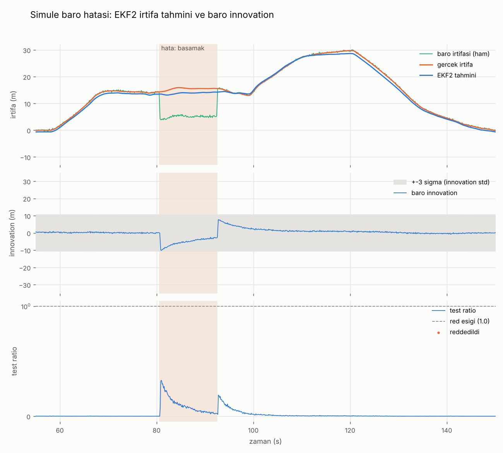
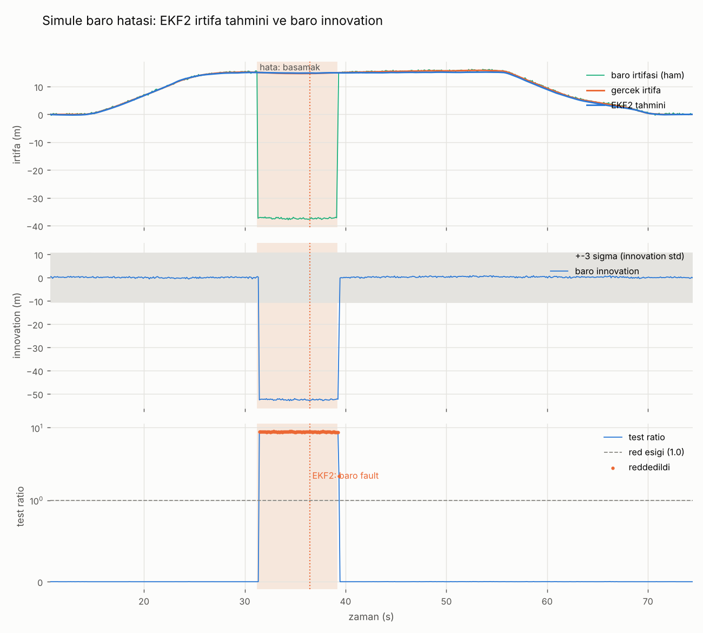

# 6. Kendi modülüm, simüle baro sürücüsü ve MAVLink ile görev

Bu bölümde PX4'e iki modül ekledim ve aracı MAVLink üzerinden bir Python scriptiyle uçurdum:

1. `attitude_monitor`: work queue üzerinde çalışan, olay tetiklemeli bir modül. `vehicle_attitude` ve `sensor_combined` okuyor, kendi `attitude_monitor` topic'ini yayınlıyor.
2. `baro_noise_sim`: hata modeli ayarlanabilen simüle bir barometre sürücüsü. Uçuş sırasında hata enjekte edip EKF2'nin tepkisini loglardan inceledim.
3. `scripts/mission.py`: pymavlink ile arm, kalkış, görev yükleme ve iniş.

Kod fork'umda: [batuuhnk/PX4-Autopilot, learning/sitl-week1](https://github.com/batuuhnk/PX4-Autopilot/tree/learning/sitl-week1)

```
src/modules/attitude_monitor/           AttitudeMonitor.cpp/.hpp, parameters.c, CMakeLists.txt, Kconfig
src/modules/simulation/baro_noise_sim/  BaroNoiseSim.cpp/.hpp, parameters.c, CMakeLists.txt, Kconfig
msg/AttitudeMonitor.msg                 yeni uORB mesajı
boards/px4/sitl/default.px4board        iki modülü SITL derlemesine ekler
ROMFS/.../px4-rc.sihsim                 SIH açılışında modülleri başlatır (AM_EN, BNS_EN)
src/modules/logger/logged_topics.cpp    attitude_monitor topic'ini loglar
```

## 6.1 attitude_monitor: olay tetiklemeli work queue modülü

### Ne yapıyor

Her yeni `vehicle_attitude` örneğinde çalışıyor ve şunları yayınlıyor:

| Alan | Açıklama |
|---|---|
| `roll`, `pitch`, `yaw` | quaternion'dan Euler açıları (rad) |
| `tilt` | gövde z ekseni ile dikey arasındaki açı: `acos(R(2,2))` |
| `gyro_norm` | `sensor_combined`'dan son açısal hızın büyüklüğü |
| `dt_us`, `dt_max_us` | ardışık iki attitude örneği arasındaki süre ve görülen en büyük değer |
| `tilt_warning` | tilt `AM_TILT_WARN` (varsayılan 30 derece) üstündeyken true, 2 derece histerezis ile |

### Yapı

```
EKF2 --vehicle_attitude--> [SubscriptionCallbackWorkItem] --Run() kuyruğa alınır--> lp_default work queue
                                                                     |
sensors --sensor_combined--> [Subscription] (uyandırmaz, sadece son değer okunur)
                                                                     v
                                                     attitude_monitor topic (uORB)
```

Önemli seçimler:

- **`SubscriptionCallbackWorkItem`**: modül periyodik olarak uyanıp veri var mı diye bakmıyor. Yeni attitude yayınlandığında uORB modülün `Run()`'ını work queue'ya koyuyor. FreeRTOS'ta bir task'ı `osDelay` ile döndürmek yerine queue'dan beklemesiyle aynı mantık. AHRS projemde yaptığım düzeltmeyle birebir aynı fikir.
- **`sensor_combined` için düz `Subscription`**: ikinci bir topic modülü uyandırmasın diye. Aksi halde `Run()` iki kaynaktan tetiklenir ve aynı attitude iki kez işlenebilir.
- **`lp_default` (düşük öncelikli) work queue**: izleme kodu EKF2'yi ya da kontrolcüleri asla geciktirmemeli. Simüle baro sürücüsü ise gerçek sürücüler gibi `hp_default`'ta.
- **`dt`, `timestamp_sample`'dan hesaplanıyor**: `Run()`'ın çalıştığı andan değil, verinin örneklendiği andan. Zamanlama gecikmesi ölçümü bozmasın diye.
- **perf sayaçları**: `attitude_monitor status` ile döngü süresi ve aralık istatistiği görülüyor.

### Çalıştırma

```bash
./scripts/pxh.sh attitude_monitor status
./scripts/pxh.sh listener attitude_monitor
```

`AM_EN=1` (varsayılan) olduğunda SIH açılışında kendiliğinden başlıyor. Örnek çıktı:

```
INFO  [attitude_monitor] roll 0.1  pitch 0.1  yaw -0.4  tilt 0.2 deg
INFO  [attitude_monitor] gyro norm 0.006 rad/s, dt 4000 us, dt max 8000 us, tilt warning no
attitude_monitor: interval: 742 events, 4000.00us avg, min 4000us max 8000us 146.844us rms
```

Attitude 250 Hz geliyor (4 ms). Açılışta bir kez 8 ms görülüyor; EKF2'nin başlangıçta bir örnek kaçırması. Görev uçuşunda 3099 örnekte dt hep 4000 us kaldı, en büyük tilt 28.2 derece oldu (uyarı eşiğinin altında).

## 6.2 baro_noise_sim: simüle barometre sürücüsü

### Neden

Gerçek bir sürücü gibi `sensor_baro` yayınlayan, ama hatasını benim kontrol edebildiğim bir barometre istedim. Böylece "baro bozulursa EKF2 ne yapar?" sorusunu loglarla cevaplayabildim.

### Model

```
SIH gerçek irtifa (vehicle_global_position_groundtruth)
   -> ISA atmosfer modeli: p = 101325 * (T/288.15)^5.2559,  T = 288.15 - 0.0065 * h
   -> + bias (BNS_DRIFT ile zamanla büyür)
   -> + beyaz gürültü (BNS_NOISE, Box-Muller ile N(0,1))
   -> hata modu (BNS_FAULT)
   -> sensor_baro (PublicationMulti, kendi device_id'si)
```

| Parametre | Varsayılan | Açıklama |
|---|---|---|
| `BNS_EN` | 0 | 1 ise SIH açılışında başlar |
| `BNS_NOISE` | 3 Pa | gürültü standart sapması (yaklaşık 12 Pa = 1 m) |
| `BNS_DRIFT` | 0 Pa/s | bias kayması |
| `BNS_FAULT` | 0 | 0 yok, 1 takılı kalma, 2 basamak (`BNS_STEP`), 3 kesinti |
| `BNS_STEP` | 120 Pa | basamak hatasının büyüklüğü |
| `BNS_RATE` | 20 Hz | çıkış hızı, çalışırken değiştirilebilir |

Gerçek sürücülerden aldığım detaylar:
- **`PublicationMulti`**: her barometre kendi `sensor_baro` instance'ında yayınlanıyor, `sensors` modülü bunları oylayıp birini seçiyor.
- **Ayrı `device_id`** (`DRV_BARO_DEVTYPE_BAROSIM`, SIMULATION bus 2, adres 5): kalibrasyon slotu ve öncelik bu kimliğe bağlı.

### Karşılaştığım sorun: çalışırken baro değiştirmek

İlk denemede `sensor_baro_sim stop` ile PX4'ün kendi simüle barosunu durdurup benimkini başlattım:

```
ERROR [vehicle_air_data] BARO #0 failed:  TIMEOUT!
INFO  [vehicle_air_data] BARO switch from #0 -> #1
WARN  [health_and_arming_checks] Preflight Fail: No valid data from Baro 0
```

`sensors` modülü #0'ın kesildiğini fark edip #1'e (benim sürücüme) geçti, bu iyi. Ama arming kontrolü kaybolan barometreyi hata olarak görmeye devam etti. Çözüm: iki parametre ve yeniden başlatma, böylece benim sürücüm açılıştan itibaren tek barometre (instance 0):

```bash
./scripts/pxh.sh param set SENS_EN_BAROSIM 0
./scripts/pxh.sh param set BNS_EN 1
# PX4'ü yeniden başlat
```

## 6.3 MAVLink görev scripti

`scripts/mission.py`, QGC'de düğmeyle yaptığım işi MAVLink protokolüyle yapıyor:

```
heartbeat bekle -> GLOBAL_POSITION_INT ile EKF2 hazır mı
-> MISSION_COUNT -> (MISSION_REQUEST_INT -> MISSION_ITEM_INT) x 5 -> MISSION_ACK
-> COMMAND_LONG(ARM) -> COMMAND_LONG(DO_SET_MODE: AUTO.MISSION)
-> MISSION_ITEM_REACHED ve HEARTBEAT ile izle -> disarm
```

```bash
pip install pymavlink
python3 scripts/mission.py                              # takeoff, 30 m kare, RTL
python3 scripts/mission.py --takeoff-only --hover 30    # kalk, 30 s bekle, in
```

PX4'ün "onboard" MAVLink kanalı UDP 14540'a gönderiyor, QGC 14550'yi kullanıyor. Yani script QGC açıkken de çalışıyor.

Yolda çözdüğüm üç sorun, hepsi PX4 kaynak kodunda karşılığını bulduğum şeyler:

1. **RTL reddedildi** (`MAV_MISSION_UNSUPPORTED_FRAME`). Konumu olmayan RTL öğesini de `GLOBAL_RELATIVE_ALT_INT` ile göndermiştim. `mavlink_mission.cpp` bu komutları sadece `MAV_FRAME_MISSION` ile kabul ediyor.
2. **Kalkış hiç olmadı** (`navigator: Already higher than takeoff altitude`). `MAV_CMD_NAV_TAKEOFF`'un param7'si home'a göre değil deniz seviyesine göre (AMSL) irtifa. 15 m gönderince, 488 m'deki araç zaten "yüksekte" sayıldı. Home AMSL irtifasına ekleyerek düzelttim.
3. **Mod komutunun ACK'i kayboldu**. Havada beklerken `time.sleep(10)` kullanmıştım. Onboard kanal yüksek hızlı olduğu için UDP tamponu doldu ve `COMMAND_ACK` biriken mesajların arkasında kalıp zaman aşımına uğradı (komut aslında uygulanmıştı). Beklerken mesajları okumaya devam eden `drain()` ile çözdüm. Gömülü tarafta bir UART RX tamponunu boşaltmayı unutmakla aynı hata.

## 6.4 Deney: uçuşta baro hatası ve EKF2'nin tepkisi

Analiz scripti: `analysis/baro_fault.py`. Hata aralıklarını logdaki `BNS_FAULT` parametre değişikliklerinden kendisi buluyor.

```bash
python3 analysis/baro_fault.py <log.ulg> analysis/plots
```

EKF2 ayarları (SIH varsayılanı): `EKF2_HGT_REF=1` (irtifa referansı GPS), `EKF2_BARO_NOISE=3.5 m`, `EKF2_BARO_GATE=5` (sigma).

### Deney A: 120 Pa basamak (yaklaşık 10 m), görev sırasında 12 s



```
normal : innovation ort +0.87 m, std 1.41 m, test ratio max 0.19, reddedilen %0
hata   : innovation ort -5.18 m, std 1.99 m, test ratio max 0.33, reddedilen %0
EKF2 irtifa hatası (uçuşta): max 2.16 m
```

- Test ratio en fazla 0.33 oldu, yani EKF2 hatalı ölçümü **reddetmedi**. 10 m'lik sapma, baro için ayarlanmış belirsizliğin (3 sigma yaklaşık 10.5 m) içinde kalıyor.
- Buna rağmen tahmin gerçek irtifadan en fazla 2.2 m saptı. Innovation hata boyunca sıfıra doğru azaldı: EKF2 farkı **baro bias'ı** olarak öğrendi (GPS irtifa referansı olduğu için). `estimator_baro_bias` topic'inde bias 12 s içinde 0'dan -7 m'ye indi, hata kalkınca yavaşça geri döndü. Hata kalkınca innovation'da ters yönde aynı geçici durum oluştu.
- Ders: küçük ve yavaş hatalar gate'ten geçer; onları yakalayan şey innovation kontrolü değil, bias tahmini ve ikinci bir irtifa kaynağı.

### Deney B: 600 Pa basamak (yaklaşık 52 m), hover sırasında 8 s



```
hata   : innovation ort -46.30 m, test ratio max 8.93, reddedilen %89
EKF2 irtifa hatası (uçuşta): max 0.66 m
EKF2 baro fault kararı: hata başladıktan 5.2 s sonra, baro fuse durdu
```

- Test ratio hemen yaklaşık 9'a çıktı (eşik 1), ölçümler **reddedildi**. Tahmin gerçek irtifadan 0.7 m'den fazla sapmadı.
- Yaklaşık 5 saniye boyunca sürekli reddedilince EKF2 barometreyi hatalı ilan etti (`cs_baro_fault`) ve baro füzyonunu kapattı (`cs_baro_hgt` false). Araç GPS irtifasıyla uçmaya devam etti. 5 saniye, `baro_height_control.cpp`'deki `hgt_fusion_timeout_max` (5 s). Kod, füzyon bu süre boyunca başarısızsa ve başka bir irtifa kaynağı (burada GPS) hâlâ çalışıyorsa baroyu hatalı sayıyor; hiçbir kaynak çalışmıyorsa baroyu hatalı saymak yerine irtifayı baroya sıfırlıyor.
- **Hata kalktıktan sonra da bayrak kalıyor.** İnişten sonra arming reddedildi: `Arming denied: Resolve system health failures first`. EKF2 hatalı ilan ettiği sensöre, yeniden başlatılana kadar güvenmiyor. Uçuş sırasında doğru davranış; ama sahada "neden arm olmuyor" sorusunun cevaplarından biri.

### İki deneyin özeti

| | 10 m basamak | 52 m basamak |
|---|---|---|
| Innovation testi | geçti (0.33) | kaldı (8.9) |
| EKF2 ne yaptı | farkı bias olarak öğrendi | ölçümü reddetti, 5 s sonra sensörü devre dışı bıraktı |
| En büyük irtifa hatası | 2.2 m | 0.7 m |
| Kalıcı etki | yok | `cs_baro_fault` yeniden başlatmaya kadar kalır |

İlginç sonuç: büyük hata, küçük hatadan daha az irtifa hatasına yol açtı. Büyük hata hemen fark edilip dışarıda tutuldu; küçük hata ise kabul edilip yavaşça bias'a çevrildi.

## Kod okurken baktığım yerler

| Konu | Dosya |
|---|---|
| Work queue modül örneği | `src/examples/work_item/WorkItemExample.cpp` |
| Simüle baro referansı | `src/modules/simulation/sensor_baro_sim/SensorBaroSim.cpp` |
| Baro seçimi ve timeout | `src/modules/sensors/vehicle_air_data/VehicleAirData.cpp` |
| Mission frame kontrolü | `src/modules/mavlink/mavlink_mission.cpp` |
| Baro füzyonu ve fault | `src/modules/ekf2/EKF/aid_sources/barometer/baro_height_control.cpp` |
